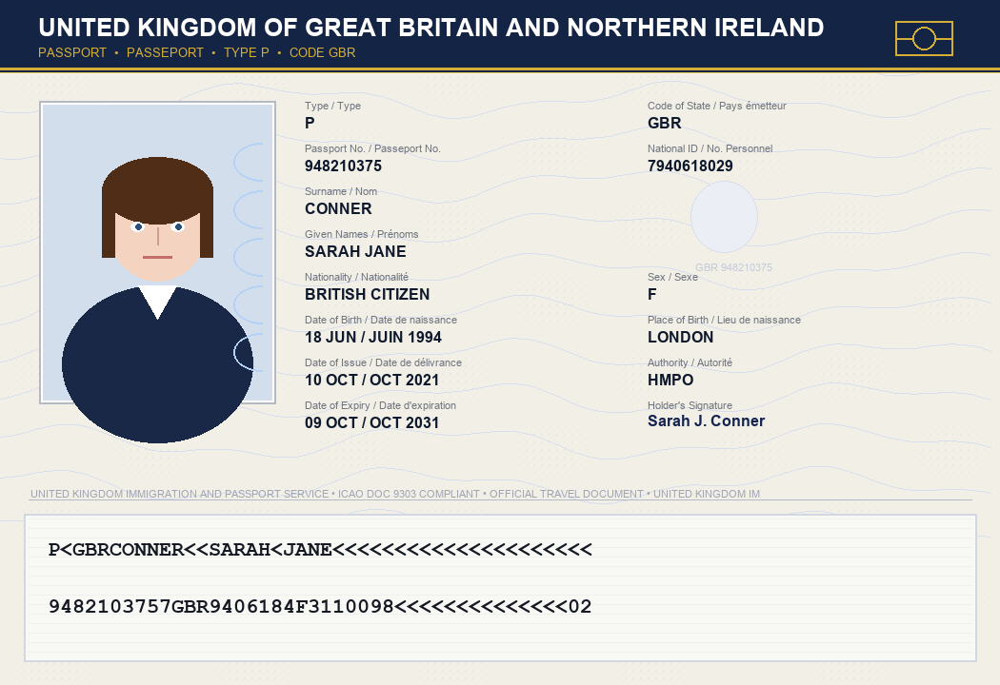

# SENTINEL-8000 // Document & Identity Forensics Workstation



**SENTINEL-8000** (Release `VSC-STD v4.8`) is a high-precision, air-gapped optical travel document inspection, identity forensics, and 1:1 biometric comparison workstation. Designed for border control checkpoints, immigration authorities, and forensic document examiners, the system operates **100% offline** in the browser with zero external network requests or third-party cloud dependencies.

---

## 📋 Table of Contents
- [Key Features & Forensic Capabilities](#key-features--forensic-capabilities)
- [Quick Start & Launch Options](#quick-start--quick-launch-options)
- [Preloaded Evaluation Scenarios](#preloaded-evaluation-scenarios)
- [System Architecture & File Structure](#system-architecture--file-structure)
- [Keyboard Shortcuts](#keyboard-shortcuts)
- [Integrity Testing & Air-Gap Audit](#integrity-testing--air-gap-audit)
- [Technical Specifications](#technical-specifications)

---

## 🔍 Key Features & Forensic Capabilities

### 1. Multi-Spectral & Optical Document Examination
* **Multi-View Modes**: Toggle between Standard White Light (Vis) inspection and real-time **Error Level Analysis (ELA)**.
* **Canvas-Based ELA Forensics**: Performs digital recompression differential mapping directly on HTML5 Canvas to expose image tampering, spliced heads, and edited text blocks.
* **Forensic Loupe (4× Precision Magnifier)**: Dynamic optical inspection tool with crosshairs to analyze guilloche patterns, microprinting, and security threads.
* **Security Grid & Edge Invert Filters**: Pixel-level raster alignment grid and high-contrast inverse edge detection for spotting physical erase marks or typography distortions.

### 2. ICAO 9303 Checksum Engine
* **MRZ Parsing**: Parses Machine Readable Zone (MRZ) formats (TD-3 two-line standard).
* **7-3-1 Modulo 10 Checksum Validation**:
  * Document Number check digit verification
  * Date of Birth (DOB) check digit validation
  * Expiration Date check digit calculation
  * Full composite check digit verification across all data segments
* **Visual vs. Encrypted Zone Cross-Matching**: Detects discrepancies between the printed visual inspection zone (VIZ) and the encoded MRZ string.

### 3. Biometric Sensor Bay & 1:1 Facial Comparison
* **Facial Geometry Analysis**: Extracts and correlates key facial landmarks (interpupillary distance, nasal base offset, lip curvature, jaw contour).
* **1:1 Facial Matching**: Compares extracted document photo against live traveler capture, calculating a similarity score and confidence metric.
* **Live Hardware Webcam Support**: Streams live traveler camera feed via WebRTC `getUserMedia()` when hosted on local loopback.
* **Simulated Sensor Feed**: Fully functional fallback traveler portrait feed for air-gapped environments without attached USB optical hardware.

### 4. Watchlist & Threat Screening
* **Interpol Red Notice Screening**: Automated database check for wanted international fugitives.
* **Stolen & Lost Travel Documents (SLTD)**: Flagging of reported invalid serial numbers and expired travel credentials.

### 5. Synthesized Hardware Audio Relays
* Powered by the **Web Audio API** with zero external audio assets.
* Simulates physical industrial relay clicks, laser line sweeps, success chimes, and alert sirens.

---

## 🚀 Quick Start & Launch Options

SENTINEL-8000 requires no compilation, installation, or internet access. Launch using either of the provided batch scripts:

### Method A: Direct Offline Launch (No Web Server Required)
Double-click [`open_offline.bat`](file:///f:/New%20folder/open_offline.bat) or open [`index.html`](file:///f:/New%20folder/index.html) directly in any modern browser:
```cmd
open_offline.bat
```
> **Note**: In `file://` mode, all forensic document features, canvas ELA, checksum checks, and simulated biometrics are fully operational. Live hardware webcams require browser localhost permissions (see Method B).

### Method B: Local Loopback Server (Live Webcam Support)
Double-click [`run_app.bat`](file:///f:/New%20folder/run_app.bat) to launch a local Python loopback server on port `8080`:
```cmd
run_app.bat
```
* **URL**: `http://localhost:8080`
* **Network Binding**: Strict local loopback (`127.0.0.1`) only; zero external telemetry.
* **Hardware Permissions**: Enables browser access to real USB/integrated webcams for live traveler verification.

---

## 🧪 Preloaded Evaluation Scenarios

The workstation includes six representative evaluation profiles covering common border control threat vectors:

| ID | Subject | Document Type | Threat / Discrepancy Vector | Expected Verdict |
|---|---|---|---|---|
| **01** | Aditya Sharma | Republic of India Passport | None (Clean, genuine document & biometrics) | **CLEAR / PASS** |
| **02** | Vikram Singh | Republic of India Passport | Altered visual DOB (`1998` vs MRZ `1985`) | **FAIL (DOB Tamper)** |
| **03** | David John Miller | United Kingdom Passport | Photo replacement / spliced portrait edge | **FAIL (ELA Anomaly)** |
| **04** | Rajesh Patel | Schengen Tourist Visa | Forged stamp & irregular duration | **FAIL (Stamp Forgery)** |
| **05** | Sarah Emily Jenkins | Canada Passport | Facial mismatch (Stolen passport / Lookalike imposter) | **FAIL (Biometric Mismatch)** |
| **06** | Carlos Enrique Mendez | Venezuela Passport | Interpol Red Notice Hit & Expired Document | **CRITICAL INTERCEPT** |

> **Custom Documents**: Operators can also drag-and-drop or upload custom scanned passport/ID files via the **Upload Document** action in the workstation console.

---

## 📁 System Architecture & File Structure

```
├── index.html                   # High-density forensic workstation layout & UI markup
├── styles.css                   # Industrial glassmorphism design system & HUD styling
├── app.js                       # Central forensic logic, ICAO 9303 engine, ELA canvas & biometrics
├── assets.js                    # Synthetic document generator, security patterns & test scenarios
├── open_offline.bat             # 1-click direct browser launcher (file://)
├── run_app.bat                  # 1-click local loopback server for live camera access
├── test_app_integrity.py        # Automated test suite (DOM audit, demo file validation, offline audit)
├── verify_files.py              # Zero-network audit script (verifies 0 external CDN or HTTP URLs)
├── generate_demo_documents.py   # Pillow script for generating high-resolution test credentials
├── create_test_passport.py      # Standalone passport template builder
├── demo_documents/              # Pre-rendered forensic test document scans (PNG)
│   ├── 01_PASS_Passport_Aditya_Sharma_Clean.png
│   ├── 02_FAIL_Passport_Viktor_Tampered_Photo.png
│   ├── 03_FAIL_Passport_Elena_Altered_DOB.png
│   ├── 04_FAIL_Visa_Rajesh_Forged_Stamp.png
│   └── 05_FAIL_Passport_Carlos_Interpol_Hit.png
└── Traveler_Passport_Scan_Official.png # Reference specimen
```

---

## ⌨️ Keyboard Shortcuts

Speed up inspection workflows using integrated tactical hotkeys:

| Key | Action |
|---|---|
| <kbd>1</kbd> – <kbd>6</kbd> | Instantly switch between test scenarios 1 through 6 |
| <kbd>V</kbd> | Switch to **Document Examination Console** |
| <kbd>B</kbd> | Switch to **Biometric Sensor Bay** |
| <kbd>L</kbd> | Toggle **Forensic Loupe (4× Magnifier)** |
| <kbd>G</kbd> | Toggle **Security Alignment Grid** |
| <kbd>E</kbd> | Toggle **Edge Inversion Filter** |
| <kbd>M</kbd> | Toggle **Audio Synthesizer (Mute / Unmute)** |
| <kbd>Space</kbd> | Trigger **Full Forensic Re-Scan** on active document |

---

## 🛡️ Integrity Testing & Air-Gap Audit

Verify code integrity and absolute air-gap compliance using the included Python verification tools:

### 1. Zero External URL Audit
```bash
python verify_files.py
```
* Scans all HTML, CSS, and JS files for external HTTP/HTTPS resources.
* Verifies `0 external URLs found`, ensuring full air-gap compliance.

### 2. Comprehensive DOM & Asset Integrity Check
```bash
python test_app_integrity.py
```
* Validates every `getElementById` call in [`app.js`](file:///f:/New%20folder/app.js) against [`index.html`](file:///f:/New%20folder/index.html).
* Confirms all generated demo files exist in `demo_documents/`.

---

## ⚙️ Technical Specifications

* **Frontend Engine**: Pure Vanilla ES6+ JavaScript, CSS3 custom properties, semantic HTML5.
* **Imaging Subsystem**: HTML5 Canvas 2D API (`ImageData` manipulation for real-time ELA diffing).
* **Audio Subsystem**: Web Audio API oscillator/gain node synthesis.
* **Hardware Interop**: WebRTC Media Capture and Streams API (`navigator.mediaDevices.getUserMedia`).
* **Checksum Standard**: ICAO Doc 9303 Part 3 / Part 4 Machine Readable Travel Documents (MRTD).
* **Browser Compatibility**: Chrome, Edge, Firefox, Safari (Modern Evergreen Browsers).
